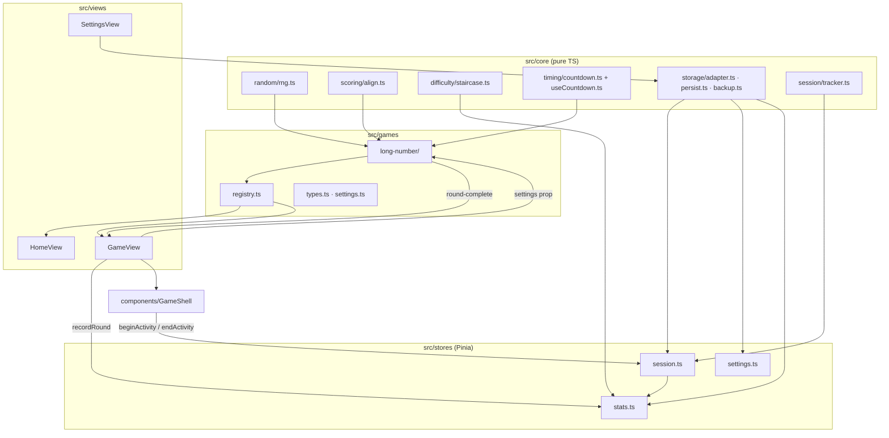

# Architecture

How the pieces of MemorizeThis connect. The source of truth is the code, so update this file when the shape changes.

## Flow of one round

1. `HomeView` lists `games` from the registry. Each tile's headline is `module.summarize(stats.roundsFor(id))`.
2. `/play/:gameId` opens `GameView`. The router guard redirects unknown ids home.
3. `GameView` puts the game's async component inside `GameShell`. The shell calls `session.beginActivity(gameId)` on mount and `endActivity()` on unmount.
4. The game snapshots `settings`, runs its phases with `useCountdown`, scores with core helpers, and emits `round-complete`.
5. `GameView` calls `stats.recordRound(gameId, result)`, which also runs `session.noteRound()`.

## Saved data (all keys start with `mt:`)

| Key | Owner | Shape |
|-----|-------|-------|
| `mt:version` | `core/storage/persist.ts` | schema version (string number) |
| `mt:settings` | `stores/settings.ts` | `{ mazeKeys, games: { [gameId]: GameSettings } }` |
| `mt:rounds` | `stores/stats.ts` | `RoundRecord[]` |
| `mt:progress` | `stores/stats.ts` | `{ [gameId]: StaircaseState }` |
| `mt:session-current` | `stores/session.ts` | the open `SessionRecord` (saved continuously) |
| `mt:sessions` | `stores/session.ts` | finished `SessionRecord[]` |
| `<key>.corrupt` | `loadJson` | raw text of a value that failed to parse (kept, never deleted) |

**Migration rule:** to change a shape, add `migrations[n]` in `core/storage/persist.ts` and bump `SCHEMA_VERSION`. Transform user data and never delete it. `main.ts` runs migrations before any store loads. If the saved version is newer than the app, the app shows a notice and touches nothing.

**Backup/restore** (`core/storage/backup.ts`): export is a JSON envelope `{ app, exportedAt, version, data }`. Restore is validated first, needs an in-page confirmation, then replaces all `mt:` keys and reloads.

## Android later

Vite `base: './'`, hash routing, and persistence only through `StorageAdapter` keep the build portable for Capacitor. The backup download uses a Blob link, which needs a Capacitor fallback (e.g. the Filesystem/Share plugins) when Android work starts.
